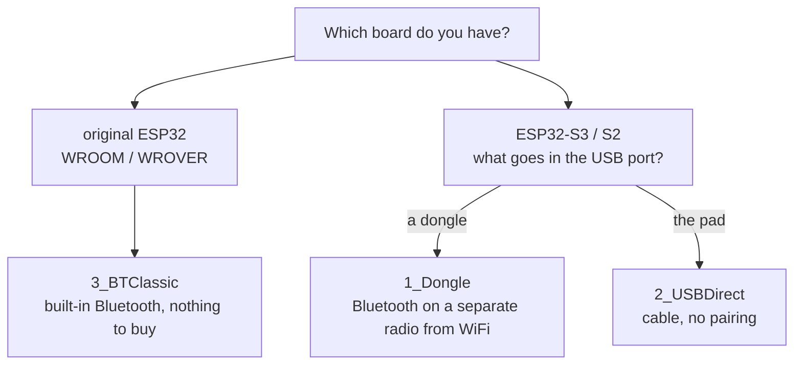
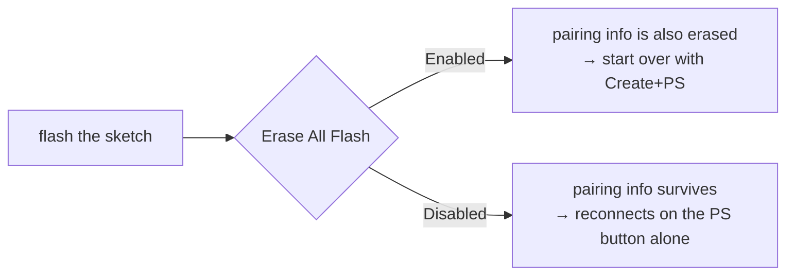
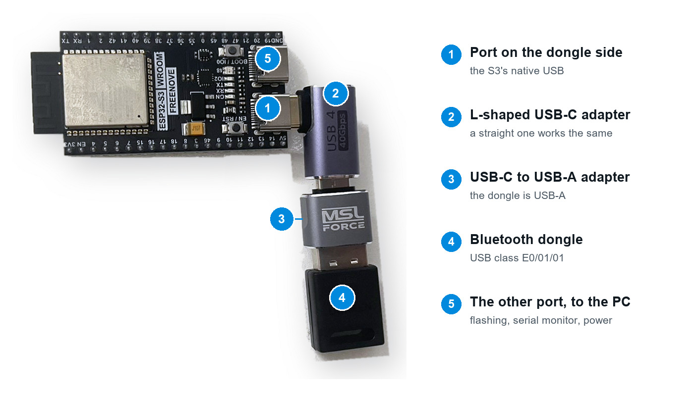
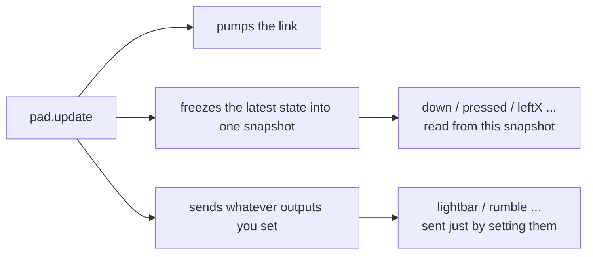
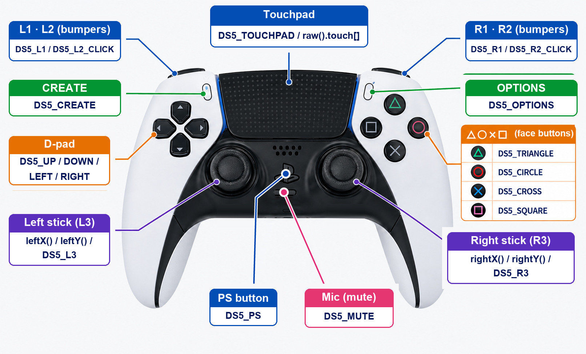

<!-- SPDX-License-Identifier: PolyForm-Noncommercial-1.0.0
     Copyright 2026 yuuki1998 -->

# DualSense32 Manual

**Supported controllers: DualSense (PS5) and DualShock 4 (PS4)**

A library for using a PlayStation controller from an ESP32. The name says
DualSense, but **a DualShock 4 (PS4) works just as well** — either pad, on any
of the three links described below. Buttons, sticks, touchpad and gyro all
read back, and the light bar colour, rumble and, on a DualSense, the adaptive
triggers (the resistance in the trigger pull) all go out.

This page walks through everything **from unzipping the release** to the
first sketch running and your own code taking over.

---

## Contents

1. [Choosing a link](#1-choosing-a-link)
2. [Installing](#2-installing)
3. [Board settings](#3-board-settings)
4. [Running the first sketch](#4-running-the-first-sketch)
5. [Reading the code](#5-reading-the-code)
6. [Every input](#6-every-input)
7. [Every output](#7-every-output)
8. [Recipes](#8-recipes)
9. [When it does not work](#9-when-it-does-not-work)
10. [Quick reference](#10-quick-reference)

---

## 1. Choosing a link

There are three ways to reach the pad. **Your board decides which.**



> **Why the S3 has no radio for this**
> The ESP32-S3 / C3 / C6 / H2 **have no Bluetooth Classic radio** — BLE only —
> and both pads speak Bluetooth Classic. So wireless on an S3 means an
> external dongle. The original ESP32 is the other way round: it has Classic,
> but no USB host, so a dongle is not an option there.

| | Board | Also needs | |
|---|---|---|---|
| **1_Dongle** | ESP32-S3 / S2 | a Bluetooth dongle (USB class `E0/01/01`) + a USB-C to USB-A adapter | wireless, on a radio separate from the ESP32's own WiFi |
| **2_USBDirect** | ESP32-S3 / S2 | a USB-C cable (C to C) | wired, no pairing |
| **3_BTClassic** | original ESP32 only | nothing | wireless, nothing to buy |

### Which controller

**Both pads work on all three links.** The route is chosen by your board, not
by which controller you own.

A DualShock 4 is the smaller instrument. It has no adaptive triggers, no
microphone and no mute button, and no player LEDs. What it has instead is a
light bar it can blink by itself, and a touchpad that is shorter than the
DualSense's. The full list is in
[6-8](#6-8-which-pad-is-on-the-other-end), and how a sketch says which pad it
was written for is in [chapter 5](#5-reading-the-code).

Nothing in this manual needs reading twice for the second pad. Where a
difference exists it is called out where that feature is explained.

### What has been checked on hardware

Worth stating plainly, because "supported" covers a lot of ground.

The DualShock 4 has been run on an **ESP32-S3**, over both the wired link and
the dongle, with a **CUH-ZCT2** pad: connected, read, driven, reconnected. The
accelerometer came out at 1.001 g and a resting gyro stayed within half a
degree per second. Those two numbers only come out right if the DualShock 4's
own offsets were used **and** the calibration was read a second time, once the
pad had said which pad it was — over Bluetooth the calibration arrives before
the pad is identified, so the link keeps the bytes and reads them again.
`5_SelfTest > Ds4Core` passes **162 protocol assertions** on the device.

**The original ESP32 route (3_BTClassic) has the code but has not been
confirmed on hardware with a DualShock 4.** It identifies the pad and decodes
its reports the same way the other links do, and nobody has yet run it with
that pad in hand. Untested rather than known broken.

---

## 2. Installing

### 2-1. Unzip the release

Unzipping the distributed `DualSense32-1.6.0.zip` gives you this:

```
DualSense32/               ← use it as is
├── Open the manual.html   ← in a browser
├── Manual.pdf              ← for printing
├── src/
├── examples/
├── docs/
│   ├── DualSense32-manual-en.html
│   ├── MANUAL-en.md
│   └── figures
├── library.properties
├── README.md
└── LICENSE
```

### 2-2. Hand it to the IDE

Without unzipping, **Sketch > Include Library > Add .ZIP Library** and
handing over the ZIP as-is works too.

### 2-3. Or drop it straight into the library folder

Move the whole `DualSense32` folder to:

| OS | Path |
|---|---|
| Windows | `Documents\Arduino\libraries\DualSense32\` |
| macOS | `~/Documents/Arduino/libraries/DualSense32/` |
| Linux | `~/Arduino/libraries/DualSense32/` |

After that it looks like:

```
Documents/Arduino/libraries/
└── DualSense32/
    ├── src/                    ← the library itself
    ├── examples/               ← the example sketches
    │   ├── 1_Dongle/
    │   ├── 2_USBDirect/
    │   ├── 3_BTClassic/
    │   ├── 4_Troubleshooting/
    │   └── 5_SelfTest/
    ├── docs/
    └── library.properties      ← this file marks the right level
```

**`library.properties` sits directly inside `DualSense32/`.** One level
deeper, as in `DualSense32/DualSense32-main/library.properties`, is not
recognised.

### 2-4. Restart the IDE and check

After restarting, open **File > Examples**. Success looks like `DualSense32`
appearing near the bottom of the list.

```
File
└── Examples
    └── DualSense32
        ├── 1_Dongle
        │   ├── Basics
        │   ├── DualShock4
        │   ├── ReceiveData
        │   └── SendData
        ├── 2_USBDirect
        ├── 3_BTClassic
        ├── 4_Troubleshooting
        └── 5_SelfTest
```

### 2-5. ESP32 board definitions (skip if already installed)

Add this URL under **File > Preferences > Additional Board Manager URLs**:

```
https://espressif.github.io/arduino-esp32/package_esp32_index.json
```

Then search for `esp32` under **Tools > Board > Boards Manager** and install
it. Developed and tested against **3.3.11**.

---

## 3. Board settings

Settings live in the **Tools** menu, and differ by link.

### 3-1. Original ESP32 (3_BTClassic)

| Item | Value | Why |
|---|---|---|
| Board | ESP32 Dev Module | |
| **Partition Scheme** | **Huge APP (3MB No OTA/1MB SPIFFS)** | **Required.** Does not fit in the default 1.25MB |
| Erase All Flash Before Sketch Upload | depends (see 3-3) | |

Forgetting the partition scheme fails the upload with
`text section exceeds available space`.

### 3-2. ESP32-S3 (1_Dongle / 2_USBDirect)

| Item | Value | Why |
|---|---|---|
| Board | ESP32S3 Dev Module, or whatever matches your board | |
| Partition Scheme | the default fits | |
| **USB CDC On Boot** | **Enabled** | this is the fix when the serial monitor stays silent |

> USB CDC is disabled by default on some boards (LOLIN S3 Mini and others).
> If the serial monitor is **completely unresponsive**, suspect this first.

### 3-3. Erase All Flash — matters for any wireless link

The ESP32 remembers pairing information in flash. **This setting decides
whether to erase that memory.**



**Set it to Enabled the first time you connect, or any time it stops
connecting.** If only one side is holding an old key, authentication keeps
failing indefinitely from then on. When that happens, the sure fix is
**Erase All Flash on the ESP32 and Create+PS on the pad** — make both sides
forget.

### 3-4. What makes a dongle usable

| Item | Requirement |
|---|---|
| USB class | `E0/01/01`. This is the mark of a standard HCI dongle |
| Radio | Bluetooth Classic (BR/EDR). **BLE-only will not work** |
| Firmware | built in. Dongles that stay inert until a host driver uploads firmware are out of scope |
| Power / speed | bus powered, ~100 mA, full speed |
| Plug | USB-A, so an S3 needs an adapter |

**The Bluetooth 5.x / 6.0 printed on the box is irrelevant.** Both pads speak
Classic, so the only thing to avoid is one explicitly marked BLE-only.

**Developed against** a **UGREEN Bluetooth 6.0 adapter** (EDR & BLE, Windows
11 / 10 / 8.1). Windows Device Manager calls it `BARROT Bluetooth 6.0
Adapter`. What the ESP32-S3 saw is below, and it needed no firmware upload.

```
vid:pid        33FA:0012
device class   E0/01/01
product        UGREEN BT6.0 Adapter
speed          full
configuration: 2 interfaces, 100 mA
```

That is the output of `4_Troubleshooting > WhatIsOnUSB`. Your dongle is a
match if it reports something like this.

### 3-5. Where the dongle goes

The S3 has two USB-C ports. **The dongle goes in the native USB one.** Leave
the other plugged into the PC — flashing, the serial monitor, and the
dongle's own power all come through it.



*Figure 3-3 — plugging in the dongle. The board pictured is a Freenove
ESP32-S3-WROOM*

If you cannot tell which port is native USB on your board, flash
**4_Troubleshooting > WhatIsOnUSB** and move the dongle between the two
ports. The one that reports the dongle's own descriptors is the native USB
port.

---

## 4. Running the first sketch

Open **File > Examples > DualSense32 > (your route) > Basics**.

### 4-1. Flash it

Finish the board settings from chapter 3, then flash. **The serial monitor
runs at 115200 bps.**

### 4-2. Connect the pad

**On a wire (2_USBDirect), just plug it in.** Everything from here is about
wireless.

```
       ┌─────────────────────────────────┐
       │  First time, or after Erase Flash│
       └─────────────────────────────────┘

         ①  Hold down CREATE
                    ↓
         ②  and press PS while still holding it
                    ↓
         ③  let go once the light bar flashes quickly
                    ↓
              pairing mode
                    ↓
         the ESP32 finds it and connects on its own


       ┌─────────────────────────────────┐
       │  After the first time (remembered)│
       └─────────────────────────────────┘

              just press PS
```

**CREATE** is the small button at the top left of the touchpad, on the
controller's left side.

**On a DualShock 4 that button is called SHARE**, and the sequence is the
same one: hold SHARE, then press PS while still holding it, and let go once
the light bar flashes quickly. SHARE is the small button left of the
touchpad — the same place a DualSense puts CREATE, with Sony's older name
printed on it.

### 4-3. Did it work?

- **Hold the ✕ button down** → the light bar turns red, both motors spin
- **Let go** → back to light blue, the vibration stops
- **Push the left stick** → a line like `left stick 45,-12` appears in the
  serial monitor

---

## 5. Reading the code

This is the whole of `Basics`. **It is all of it** — every other example just
adds display on top of this.

```cpp
#include <DualSense32.h>

DualSense32 pad;                       // ① set it up

void setup() {
  Serial.begin(115200);
  if (!pad.begin()) Serial.println("begin failed");   // ② start it
}

void loop() {
  pad.update();                        // ③ call this every time
  if (!pad.connected()) return;

  if (pad.pressed(DS_CROSS))  Serial.println("cross down");   // ④ listen
  if (pad.released(DS_CROSS)) Serial.println("cross up");

  if (pad.down(DS_CROSS)) {
    pad.lightbar(255, 0, 0);           // ⑤ command it
    pad.rumble(120, 120);
  } else {
    pad.lightbar(0, 160, 255);
    pad.rumble(0, 0);
  }
}
```

### ① Set it up — this line alone decides the link

```cpp
DualSense32 pad;                       // automatic: the built-in radio on an
                                       // original ESP32, a dongle on an S3/S2
DualSense32 pad(ds_link_usb_hid());    // wired (S3)  + #include <ds_link_usb_hid.h>
```

**No argument is the ordinary form**, and `#include <DualSense32.h>` is then the
only include needed. An original ESP32 has a Bluetooth Classic radio and no USB
host controller; an S3 or S2 is the other way round. Once the chip is known,
there is only one way to reach a pad wirelessly, and the library takes it.

**Only the cable needs saying out loud.** On an S3 a dongle and a pad go into
the same USB port, and nothing at compile time distinguishes them; the dongle is
the default.

Naming a link explicitly always works:

```cpp
DualSense32 pad(ds_bt_bluedroid());    // original ESP32  + #include <ds_bt_bluedroid.h>
DualSense32 pad(ds_link_usb_hci());    // dongle          + #include <ds_link_usb_hci.h>
```

**The three routes differ by this one line.** Nothing below it changes, not
even a character.

### ② Start it

```cpp
pad.begin();                        // search on its own; finds a pad in pairing mode
pad.begin("AA:BB:CC:DD:EE:FF");     // connect only to this one pad
```

`pad.begin()` alone is enough unless several pads are nearby. A mistyped
address shows up immediately as `false`.

**The address can be read back once connected.** After pairing and
connecting once:

```cpp
char who[18];
if (pad.address(who)) Serial.println(who);   // 24:A6:FA:23:12:64
```

With `pad.printEvents(Serial)` running, the moment it connects prints one
line: `link: connected 24:A6:FA:23:12:64`. Identical on all three routes.

### ③ Call this every time

```cpp
pad.update();
```

Forget this one line and **buttons stop responding and the light bar stops
changing colour**, because talking to the controller only happens here.
Nothing errors.



Data from the controller arrives on a **communication task running in the
background**. Reading it directly gives a mix — the stick from this instant,
a button from a moment ago. `update()` copies that instant, so everything
read afterwards **comes from the same moment**.

### ④ Listen / ⑤ Command

Outputs are **just set**. There is no need to call `send()` — `update()`
sends them.

### Which controller — the two ways to say it

Everything above is identical on a DualSense and a DualShock 4. What is not
identical is the hardware: a DualShock 4 has no adaptive triggers, no
microphone and no player LEDs. A sketch has to decide what to do about that,
and there are two answers. **Pick one on purpose** — they fail in completely
different places.

| | `DualSense32` + `supports()` | `#include <DualShock4.h>` |
|---|---|---|
| decided | while it runs | when it compiles |
| takes | whichever pad turns up | one pad |
| a call the pad cannot honour | returns false, is counted, and is reported | does not build |

#### One binary, either pad

Keep `DualSense32` — nothing changes — and ask the pad what it has.

```cpp
if (pad.supports(DS_CAP_ADAPTIVE_TRIGGERS)) pad.triggerRight(block);
if (pad.supports(DS_CAP_PLAYER_LEDS))       pad.playerLeds(10101);
```

Ask what the sketch needs rather than which pad it is. `supports()` describes
the hardware, so code written against it keeps working when a pad this library
predates turns up. The full flag list is in
[6-8](#6-8-which-pad-is-on-the-other-end).

The setters that touch optional hardware return `bool`, a refused call changes
nothing, and the refusals are counted so they cannot pass unnoticed —
[7-7](#7-7-calls-a-pad-cannot-honour).

#### One pad, named at compile time

```cpp
#include <DualShock4.h>
#include <ds_link_usb_hid.h>

DualShock4 pad(ds_link_usb_hid());
```

`DualShock4` is the same class with the missing hardware taken away rather
than left to fail quietly. The calls that would have been refused **do not
build**, and the error names the line:

```
error: use of deleted function 'bool DualShock4::triggerRight(...)'
error: use of deleted function 'bool DualShock4::micLed(uint8_t)'
error: use of deleted function 'bool DualShock4::playerLeds(...)'
```

Buttons can use the shared `DSButton` names (`DS_CROSS`, `DS_CREATE`) or the `DS4Button` aliases when you want Sony's printed names (`DS4_SHARE`).
There is no `DS4_MUTE` at all, because there is no microphone and no button
for one, so reaching for the mute button is not a call that answers false for
ever — it is:

```
error: 'DS4_MUTE' was not declared in this scope
```

Writing `DS5_CROSS` here fails too. The shared spelling is `DS_CROSS`; using the pad-specific DualSense alias says the sketch was written against the other controller, which is worth catching while it is still cheap.

> **Why a `#define` cannot do this job.** The Arduino builder compiles a
> library's `.cpp` files on their own, separately from the `.ino`. A macro set
> in the sketch never reaches them, so it cannot change what the library is.
> A **type** is the one thing that crosses that boundary — which is why this
> is a class and not a switch.

One check has to stay at run time, because **a USB port cannot be asked in
advance what will be plugged into it**. So `connected()` is true only once a
real DualShock 4 is on the other end, and `mismatched()` is true when a
DualSense turned up instead.

```cpp
void loop() {
  pad.update();
  if (pad.mismatched()) return;      // a DualSense turned up: wrong sketch
  if (!pad.connected()) return;

  if (pad.pressed(DS_CREATE)) Serial.println("share");
}
```

Without that check a DualSense's reports would be decoded as a DualShock 4's:
no crash, no error, just a sketch that never sees a button.

---

## 6. Every input

### 6-1. What the buttons are called



*Figure 6-1 — the controls and their names in code. L1 / L2 / R1 / R2 are on
the far side*

| The control | Name in code |
|---|---|
| ↑ → ↓ ← | `DS_UP` `DS_RIGHT` `DS_DOWN` `DS_LEFT` |
| □ ✕ ○ △ | `DS_SQUARE` `DS_CROSS` `DS_CIRCLE` `DS_TRIANGLE` |
| L1 R1 | `DS_L1` `DS_R1` |
| L2 R2 pulled **all the way** | `DS_L2_CLICK` `DS_R2_CLICK` |
| CREATE / OPTIONS | `DS_CREATE` `DS_OPTIONS` |
| stick click | `DS_L3` `DS_R3` |
| PS / touchpad click / mute | `DS_PS` `DS_TOUCHPAD` `DS5_MUTE` |

Those names are the ones to use on **either** pad while the sketch is a
`DualSense32`. Write it as a `DualShock4` instead
([chapter 5](#5-reading-the-code)) and the shared `DS_*` names still work. Use the `DS4_*` aliases only when you want the names printed on that controller:

| | DualSense | DualShock 4 |
|---|---|---|
| the small button left of the touchpad | `DS_CREATE` | `DS_CREATE` |
| the mute button | `DS5_MUTE` | there is none, and no name for one |
| everything else | `DS_CROSS`, `DS_L1` … | `DS_CROSS`, `DS_L1` … the same list |

On a DualShock 4 read through `DualSense32`, `pad.down(DS5_MUTE)` is always
false. That is not a pad holding still: there is no mute button, and the bits
in that position carry a report counter, so decoding them as a button would
give a mute that flickers on its own. The read is counted as a refusal —
[7-7](#7-7-calls-a-pad-cannot-honour).

### 6-2. down / pressed / released

The three are **all different**.

```
button        ┌────────────────────┐
state    ─────┘                    └──────────

down()        ░░░░░░░░░░░░░░░░░░░░░░       true the whole time it is held
pressed()     ▓                            true for one instant, on press
released()                          ▓      true for one instant, on release
```

```cpp
// spin a motor while it is held → down
if (pad.down(DS_R1)) motorOn(); else motorOff();

// fire exactly once per press → pressed
if (pad.pressed(DS_R1)) fire();

// write fire() under down and it keeps firing for as long as it's held
// (hundreds of times a second)
```

Write `down()` where `pressed()` belongs and the code runs continuously
while the button is held. **What was meant to happen once now happens
hundreds of times a second.**

### 6-3. Sticks

```cpp
int x = pad.leftX();    // -128..127, 0 in the middle
int y = pad.leftY();
int rx = pad.rightX();
int ry = pad.rightY();
```

```
         leftY = -128 (up)
                 ↑
   -128 ←───────┼───────→ +127     leftX
   (left)        │       (right)
                 ↓
         leftY = +127 (down)
```

> **Y is positive downward.** Pushing up gives a negative number. To drive a
> vehicle forward, use `-pad.leftY()`.

**A few counts of drift remain even with your hand off the stick.** Ignore
it and a robot creeps with nobody touching it. This is what the deadzone is
for.

```cpp
pad.deadzone(8);    // anything within ±8 counts as 0 (the default)
pad.deadzone(0);    // disabled, if you want the raw value
```

### 6-4. Triggers

L2 / R2 give **two** readings: how far in it is pressed, and whether it has
been pulled all the way.

```cpp
uint8_t r = pad.r2();               // 0..255, analogue
bool clicked = pad.down(DS_R2_CLICK);   // pulled all the way
```

```cpp
analogWrite(motorPin, pad.r2());    // the throttle itself
```

A DualShock 4 reads exactly the same way. Its triggers are springs, so what
it does not have is the resistance on the way in
([7-5](#7-5-adaptive-triggers--resistance-in-the-trigger-pull)).

### 6-5. Touchpad

Read from `raw()`. **Up to two fingers** are tracked at once.

```cpp
const ds_state_t &s = pad.raw();

if (s.has_touch && s.touch[0].active) {
  Serial.printf("finger 1  %u,%u (id %u)\n",
                s.touch[0].x, s.touch[0].y, s.touch[0].id);
}
```

```
      (0,0)                                    (1919,0)
        ┌────────────────────────────────────────┐
        │                                        │
        │                touchpad                │
        │                                        │
        └────────────────────────────────────────┘
      (0,1079)                                (1919,1079)
```

**A DualShock 4's touchpad is the same width and shorter: 1920 x 942.** Same
width, so x needs nothing; scale y to the pad you actually have, or a finger
at the bottom edge reads as seven eighths of the way down.

`id` is **a number that increases each time a finger lands.** It stays the
same while a finger drags, so `id` tells apart a continuing stroke from a
finger lifted and placed again.

### 6-6. Gyro and accelerometer

**Both come back in units you can use directly.** No dividing required.

```cpp
float dps = pad.gyroYaw();     // deg/s. gyroPitch() / gyroRoll() are the same
float g   = pad.accelZ();      // g. one axis reads about 1.0 at rest
```

When the raw number itself is what you want, there are three choices.

| Accessor | Returns | Use it when |
|---|---|---|
| `pad.gyroYaw()` / `pad.accelZ()` | **deg/s** and **g** (float) | you want angular velocity or acceleration ready to use |
| `pad.raw().motion` | calibrated LSB values (integer) | you want to stay in integers |
| `pad.rawMotion()` | pre-calibration LSB values (integer) | you want to see what calibration changed |

> **Mind the scale if you divide by hand.** The two sensors use different
> scales: the gyro is 1024 counts per deg/s, the accelerometer 8192 counts
> per g. The constants are public as `DS_GYRO_LSB_PER_DPS` and
> `DS_ACCEL_LSB_PER_G`. Assume they match and dividing is off by a factor
> of sixty.

A DualShock 4 is calibrated too, from its own feature report and its own
layout, and the library reads whichever the connected pad keeps. Nothing above
changes on that pad.

### 6-7. Battery

```cpp
uint8_t level = pad.battery();     // 0..10 (1 is roughly 10%)
bool charging = pad.charging();
```

### 6-8. Which pad is on the other end

```cpp
if (pad.isDualShock4()) Serial.println("a PS4 pad");

if (pad.supports(DS_CAP_ADAPTIVE_TRIGGERS)) pad.triggerRight(block);
```

**Prefer `supports()` to `isDualShock4()`.** It says what the hardware can do
rather than what name it goes by, so the sketch keeps working when a pad this
library predates turns up. Both are only meaningful once connected; before
that the answer is the DualSense set, because that is what an unidentified pad
is assumed to be.

| Flag | What it is | DualSense | DualShock 4 |
|---|---|---|---|
| `DS_CAP_ADAPTIVE_TRIGGERS` | L2 / R2 push back | yes | no |
| `DS_CAP_MIC_LED` | the lamp on the mute key | yes | no |
| `DS_CAP_MUTE_BUTTON` | there is a microphone to mute | yes | no |
| `DS_CAP_PLAYER_LEDS` | the five lamps under the touchpad | yes | no |
| `DS_CAP_LIGHTBAR_BLINK` | the pad blinks the light bar itself | no | yes |

The light bar, rumble, both sticks, the triggers, the touchpad, motion and the
battery are on both pads and need no flag.

Three more differences are not flags, because nothing can be asked about them:

| | DualSense | DualShock 4 |
|---|---|---|
| touchpad | 1920 x 1080 | 1920 x 942 |
| the button left of the touchpad | CREATE | SHARE |
| blinking the light bar | your own loop does it | `lightbarBlink(on, off)` ([7-6](#7-6-blinking-the-light-bar--dualshock-4-only)) |

#### How it works out which pad it is

**On a wire, from the USB product id.** Both pads send input report `0x01` at
64 bytes, so the report itself cannot tell them apart — the product id on the
descriptor can.

| Product id | Pad |
|---|---|
| `0x05C4` | DualShock 4, CUH-ZCT1 |
| `0x09CC` | DualShock 4, CUH-ZCT2 |
| `0x0BA0` | the DualShock 4 USB adaptor |

**Over Bluetooth, from the report id.** There is no product id out there.
`0x31` is a DualSense and `0x11` a DualShock 4. Report `0x01`, which both pads
send until a feature report is asked for, identifies **nothing**, and is
deliberately not used to guess: guessing there would pick a pad at random on
the first frame of every connection. Its layout is the same on both pads, so
it decodes correctly anyway while the answer is still unknown.

For a clone, or a revision newer than this code, the answer can be forced:

```cpp
#### Filling the gap — telling begin() what to expect

Only *output* suffers while the answer is unknown: the two pads build
genuinely different output reports, so one cannot be assembled until the model
is settled. `begin()` takes an expectation for that.

```cpp
pad.begin(DS_DEVICE_DUALSHOCK4);                        // expect a DS4
pad.begin(DS_DEVICE_DUALSHOCK4, "AA:BB:CC:DD:EE:FF");   // and that one pad
```

On a `DualShock4` there is nothing to write — the type has already said it, so
`pad.begin()` and `pad.begin("AA:BB:...")` expect a DualShock 4 by themselves.

Without an expectation, output is *held* rather than built wrong: a `lightbar()`
set during the gap is delivered the moment the pad names itself, a few frames
later, instead of going out in the wrong dialect and being ignored.

An expectation always loses to what the link works out for itself. If they
disagree, `device()` says so and `DualShock4::mismatched()` reports it.

#### Overriding the answer — for clones

A clone, or a revision newer than this code, can have the answer *overridden*
instead. Unlike an expectation, this outranks the product id.

```cpp
ds_link_usb_hid_force_device(DS_DEVICE_DUALSHOCK4);   // before begin()
```

You should not need it. Reach for it when the log says a pad attached and
every field past the sticks reads as nonsense.

---

## 7. Every output

Everything here is **just set**. `update()` sends it.

### 7-1. Light bar

```cpp
pad.lightbar(255, 0, 0);      // red
pad.lightbar(0, 160, 255);    // light blue
pad.lightbar(0, 0, 0);        // off
```

### 7-2. Rumble

```cpp
pad.rumble(left, right);      // 0..255 each
pad.rumble(0, 0);             // stop
```

Left is a heavy low rumble, right a fine high one.

### 7-3. Player LEDs

The five LEDs under the touchpad. **Write the pattern you want lit, as a
number.**

```
   pad.playerLeds(10101);   →   ●  ○  ●  ○  ●
   pad.playerLeds(  100);   →   ○  ○  ●  ○  ○
```

```cpp
pad.playerLeds(10101);        // digit-to-lamp, one to one
pad.playerLeds(  100);        // leading zeros can be dropped
pad.playerLeds(11111);        // all on
pad.playerLeds(    0);        // all off
pad.playerLeds(10101, 0);     // second argument is brightness, 0..2
```

> Already holding a 5-bit mask? `pad.playerLedsMask(0b10101)` takes one
> directly. The rightmost LED is bit zero.

**A DualShock 4 has no lamps there**, so both calls return false and change
nothing on that pad ([7-7](#7-7-calls-a-pad-cannot-honour)).

### 7-4. Mic LED

```cpp
pad.micLed(0);   // off
pad.micLed(1);   // on
pad.micLed(2);   // blinking
```

**A DualShock 4 has no microphone and no lamp for one**, so this returns false
there ([7-7](#7-7-calls-a-pad-cannot-honour)).

### 7-5. Adaptive triggers — resistance in the trigger pull

DualSense's headline feature, and the one thing on this list a DualShock 4
cannot be talked into: its triggers are springs, so every call in this section
returns false on that pad ([7-7](#7-7-calls-a-pad-cannot-honour)).

**Build an 11-byte block and hand it over.**

```cpp
uint8_t block[DS5_TRIGGER_BLOCK_SIZE];      // 11 bytes

ds5_trigger_weapon(block, 3, 6, 8);         // a gun's trigger
pad.triggerRight(block);                    // apply it to the right trigger
```

Position runs **0 to 9**: 0 is untouched, 9 is pulled all the way in.

```
   0 ─────────────────────────────────── 9
   (released)                       (bottomed out)
```

| Function | Feel | Arguments |
|---|---|---|
| `ds5_trigger_off(b)` | no resistance (reset) | — |
| `ds5_trigger_feedback(b, pos, force)` | heavy from that point on | pos 0-9 / force 0-8 |
| `ds5_trigger_weapon(b, start, end, force)` | **a gun**: resists, then breaks | start 2-7 / end start+1..8 / force 0-8 |
| `ds5_trigger_vibration(b, pos, amp, hz)` | vibrates from that point on | pos 0-9 / amp 0-8 |
| `ds5_trigger_slope(b, start, end, force1, force2)` | ramps up gradually | force 1-8 |
| `ds5_trigger_multi_feedback(b, force[10])` | resistance set per zone | each 0-8 |
| `ds5_trigger_multi_vibration(b, hz, amp[10])` | vibration set per zone | each 0-8 |
| `ds5_trigger_bow(b, start, end, force, snap)` | **a bow**: draw and release snaps | each 1-8 |
| `ds5_trigger_galloping(b, start, end, foot1, foot2, hz)` | **a gallop**: a two-beat rhythm | foot1 0-6 / foot2 foot1+1..7 |
| `ds5_trigger_machine(b, start, end, ampA, ampB, hz, period)` | **an engine**: two amplitudes alternate | amp 0-7 |

> The last three (bow, gallop, machine) are undocumented by Sony. They come
> from independent reverse-engineering, and the argument ranges are "what
> the real hardware accepted."

**To feel all of them, flash the `SendData` example.** Switch effects with
the d-pad and pull L2 / R2 to compare.

### 7-6. Blinking the light bar — DualShock 4 only

A DualShock 4 can blink its own light bar. The pad keeps the rhythm, so a
warning light costs the sketch nothing to keep going.

```cpp
pad.lightbar(255, 0, 0);       // the colour is still set the usual way
pad.lightbarBlink(50, 50);     // half a second on, half a second off
pad.lightbarBlink(200, 1);     // reads as lit: 2 s on, 10 ms off
```

> **Never pass an off of zero.** The pad takes a new colour or a new rate only
> at a blink boundary, and an off of zero leaves it with no boundary to arrive
> at: the light bar holds what it was showing and ignores what comes after
> until something else disturbs it. `lightbarBlink(0, 0)` is worse — it puts
> the bar out. Neither is "solid".
>
> For a steady-looking bar use a long on and an off of `1`. Measured on a
> DualShock 4: 10 ms of dark cannot be seen, 20 ms can, and with off at `1` a
> single report changes both the colour and the rate first time.

**Both numbers are in units of 10 ms**, so 50 is 500 ms. They are on-time and
off-time, and they do not have to match.

A DualSense has no such thing and returns false here. Blinking on both pads
means doing it in your own loop, with `millis()` and `lightbar()`.

### 7-7. Calls a pad cannot honour

Some of the hardware above is not on every pad, and the calls that reach for
it **change nothing and return false** when it is absent.

| Call | Absent on |
|---|---|
| `triggerLeft` `triggerRight` | DualShock 4 |
| `micLed` | DualShock 4 |
| `playerLeds` `playerLedsMask` | DualShock 4 |
| `lightbarBlink` | DualSense |
| reading `DS5_MUTE` | DualShock 4 |

```cpp
if (!pad.micLed(1)) Serial.println("no mic lamp on this pad");
```

Nothing is refused before the link is up. Until a pad has identified itself
there is nothing to refuse against, so an early call is carried out against
the DualSense set.

Ignoring the return is easy, and this is the one failure that leaves no trace
on the wire: the field is simply absent from the report, and a report that is
one field short looks exactly like a report that arrived. So the refusals are
counted as well.

```cpp
pad.refusedCount();     // how many calls have been dropped
pad.lastRefused();      // the name of the last one, or nullptr
pad.clearRefused();
```

And `printEvents()` says so, one line per call it had to drop:

```
unsupported: triggerRight — this pad is a DualShock 4
```

A line every frame means a setter being called every time round `loop()`.
That is worth fixing rather than silencing: guard it with `supports()`
([6-8](#6-8-which-pad-is-on-the-other-end)), or write the sketch as a
`DualShock4` and have the compiler say it once, at build time
([chapter 5](#5-reading-the-code)).

---

## 8. Recipes

### 8-1. RC car (motors from the sticks)

```cpp
#include <DualSense32.h>
DualSense32 pad;

const int PWM_L = 25, PWM_R = 26;

void setup() {
  Serial.begin(115200);
  pinMode(PWM_L, OUTPUT);
  pinMode(PWM_R, OUTPUT);
  pad.begin();
  pad.deadzone(12);          // make sure it stops when you let go
}

void loop() {
  pad.update();

  // ★ always stop when not connected
  if (!pad.connected()) {
    analogWrite(PWM_L, 0);
    analogWrite(PWM_R, 0);
    return;
  }

  int fwd  = -pad.leftY();   // inverted: pushing up reads negative
  int turn =  pad.rightX();

  int l = constrain(fwd + turn, -128, 127);
  int r = constrain(fwd - turn, -128, 127);

  analogWrite(PWM_L, abs(l) * 2);
  analogWrite(PWM_R, abs(r) * 2);
}
```

> The last value read stays put even after the radio drops. Drive off
> `leftY()` alone without checking `connected()` and **the motors keep
> spinning at whatever speed they had the instant the link died.** Zero the
> outputs while not connected.

### 8-2. Toggling on each press

```cpp
void loop() {
  pad.update();
  if (!pad.connected()) return;

  static bool lampOn = false;

  if (pad.pressed(DS_CIRCLE)) {     // ★ pressed, not down
    lampOn = !lampOn;
    digitalWrite(LAMP, lampOn);
    pad.lightbar(lampOn ? 255 : 0, 0, 0);
  }
}
```

### 8-3. Detecting a long press

```cpp
void loop() {
  pad.update();
  if (!pad.connected()) return;

  static uint32_t heldSince = 0;
  static bool fired = false;

  if (pad.down(DS_OPTIONS)) {
    if (heldSince == 0) heldSince = millis();
    if (!fired && millis() - heldSince > 1000) {
      fired = true;
      Serial.println("held for 1 second");
    }
  } else {
    heldSince = 0;
    fired = false;
  }
}
```

### 8-4. Switching modes (colour shows the current one)

```cpp
enum Mode { MANUAL, AUTO, MODE_COUNT };
Mode mode = MANUAL;

void loop() {
  pad.update();
  if (!pad.connected()) return;

  if (pad.pressed(DS_TRIANGLE)) {
    mode = (Mode)((mode + 1) % MODE_COUNT);
  }

  switch (mode) {
    case MANUAL: pad.lightbar(0, 160, 255); break;   // light blue
    case AUTO:   pad.lightbar(0, 255,   0); break;   // green
    default: break;
  }
}
```

### 8-5. Just show me everything

```cpp
void loop() {
  pad.update();
  pad.printEvents(Serial);       // one line per change
  if (pad.pressed(DS_OPTIONS)) pad.printState(Serial);   // the whole state
}
```

Useful for checking wiring or behaviour. The `ReceiveData` example is a
**hand-written version that uses neither of these**, so read that one
instead when you want to know exactly which value is read how.

---

## 9. When it does not work

| Symptom | Cause | Fix |
|---|---|---|
| gyro values are off by orders of magnitude | dividing by the accelerometer's scale | use `pad.gyroYaw()`; if dividing by hand, it is 1024 (6-6) |
| `text section exceeds available space` | default partition scheme | set **Huge APP** (original ESP32) |
| nothing in the serial monitor | USB CDC On Boot disabled | set it to **Enabled** (S3) |
| pairing mode, still no connection | the ESP32 is holding an old key | reflash with **Erase All Flash = Enabled**, and Create+PS on the pad |
| connects, then drops immediately | the two keys disagree | same as above; make **both** sides forget |
| `begin failed` | wrong address format, or the radio failed to start | check it matches `"AA:BB:CC:DD:EE:FF"` |
| it moves with nobody touching it | deadzone too small | raise it, e.g. `pad.deadzone(12)` |
| one press fires dozens of times | `down()` where `pressed()` was meant | switch to `pressed()` ([6-2](#6-2-down--pressed--released)) |
| light bar and rumble do nothing | `update()` is not being called | `pad.update()` at the top of `loop()` |
| values jump or mix together | `update()` called more than once per loop, or read from another task | call `update()` once per cycle, and read from that same task |
| worked before, now connects to nothing | the pad re-paired with something else | a pad remembers **exactly one host**; pair again |
| the first pad still connects, a **different** one is never found | a stored bond turns the scan off on purpose | `ds_link_usb_hci_clear_bond()`, then reset — see below |
| the mute button never reads as pressed | a DualShock 4 has no microphone | there is nothing to read ([6-1](#6-1-what-the-buttons-are-called)) |
| `micLed` / `playerLeds` / the trigger effects do nothing | the pad has no such hardware | check the return, or ask `supports()` first ([7-7](#7-7-calls-a-pad-cannot-honour)) |
| a `DualShock4` sketch runs and never sees a button | a DualSense is plugged in | `pad.mismatched()` says so ([chapter 5](#5-reading-the-code)) |
| everything past the sticks reads as nonsense | a clone whose product id is not in the table | `ds_link_usb_hid_force_device()` ([6-8](#6-8-which-pad-is-on-the-other-end)) |

### The bond that hides a different pad

This one deserves its own paragraph, because the symptom is indistinguishable
from a controller that will not pair. The pad flashes in pairing mode, the
ESP32 says nothing, and every obvious fix is aimed at the wrong thing.

**Once a bond is stored, the link stops running an inquiry scan on purpose.**
A pad that already knows the host pages the host itself when PS is pressed,
and a scan running at the same time would stop that page being answered. So
the host waits instead, and waiting is the right answer — for **that** pad. A
different pad, which nobody has paired yet, can only be found by the scan that
is now never run.

So the old bond has to go first:

```cpp
ds_link_usb_hci_clear_bond(pad.transport());
```

Then reset the board. `Erase All Flash Before Sketch Upload = Enabled` does
the same thing with a bigger hammer, since the bond lives in NVS
([3-3](#3-3-erase-all-flash--matters-for-any-wireless-link)).

### If nothing above fixes it

**File > Examples > DualSense32 > 4_Troubleshooting** has diagnostics.

| Example | What it shows |
|---|---|
| `DongleStepByStep` | which stage the dongle's bring-up is stuck at |
| `WhatIsOnUSB` | what is actually on the USB port, and whether the dongle is recognised |
| `EventLog` | every field received, plus a consistency check on the values |
| `Ds4PairingInfo` | which host address a DualShock 4 is still trying to call |

`Ds4PairingInfo` is for one specific silence: a DualShock 4 remembers one host
and pages it when PS is pressed, so a pad calling an address that is not there
lights up and does nothing, which looks exactly like a broken pad. Plug it in
over USB — no pairing needed — and it prints what the pad is holding.

`5_SelfTest` is the library's own self-test. **Needs no pad and no dongle**;
if everything passes, the decoding side is sound. `Ds4Core` is the DualShock 4
half of it, and the place where the two pads' report layouts are pinned apart.

---

## 10. Quick reference

### Setup

```cpp
DualSense32 pad;                        // automatic (original = radio, S3 = dongle)
DualSense32 pad(ds_link_usb_hid());    // wired (S3) is the one that must be said

pad.begin();                 // search and connect
pad.begin("AA:BB:...");      // connect to a named pad
pad.update();                // ★ every time, at the top of loop
pad.connected();             // is it connected
char who[18];
pad.address(who);            // the address of whatever is connected
pad.deadzone(8);             // stick slack
pad.sendInterval(50);        // output send interval, ms (default 50)
```

### Which pad

```cpp
pad.device();                // DS_DEVICE_DUALSENSE / DS_DEVICE_DUALSHOCK4
pad.isDualShock4();
pad.supports(DS_CAP_ADAPTIVE_TRIGGERS);   // also _MIC_LED, _PLAYER_LEDS,
                                          // _MUTE_BUTTON, _LIGHTBAR_BLINK

DualShock4 pad(ds_link_usb_hid());   // PS4 only, checked at build time
                                     // + #include <DualShock4.h>
pad.mismatched();            // DualShock4 only: a DualSense turned up

ds_link_usb_hid_force_device(DS_DEVICE_DUALSHOCK4);   // for a clone
```

### Reading

```cpp
pad.down(DS_CROSS)          // held
pad.pressed(DS_CROSS)       // the instant it went down
pad.released(DS_CROSS)      // the instant it came up
                             // DualShock4 sketches: DS_CROSS, DS_CREATE,
                             // and no DS4_MUTE at all

pad.leftX()  pad.leftY()     // -128..127 (Y is positive down)
pad.rightX() pad.rightY()
pad.l2()     pad.r2()        // 0..255

pad.battery()                // 0..10
pad.charging()

pad.raw().touch[0].x         // touchpad, 0..1919
pad.raw().touch[0].y         //           0..1079 (a DualShock 4 stops at 941)
pad.gyroPitch() / gyroYaw() / gyroRoll()   // deg/s
pad.accelX()    / accelY()  / accelZ()    // g
pad.raw().motion             // calibrated LSB values
pad.rawMotion()              // pre-calibration LSB values
```

### Writing

```cpp
pad.lightbar(r, g, b);       // 0..255 each
pad.rumble(left, right);     // 0..255 each
pad.playerLeds(10101);       // write the pattern you want lit
pad.playerLedsMask(0b10101); // if you already hold it as bits
pad.micLed(1);               // 0 off / 1 on / 2 blink
pad.lightbarBlink(50, 50);   // DualShock 4 only, units of 10 ms

uint8_t b[DS5_TRIGGER_BLOCK_SIZE];
ds5_trigger_weapon(b, 3, 6, 8);
pad.triggerLeft(b);
pad.triggerRight(b);

// all of the above return false on a pad without the hardware
pad.refusedCount();          // how many calls were dropped
pad.lastRefused();           // the name of the last one
pad.clearRefused();
```

### Inspecting

```cpp
pad.printEvents(Serial);     // only what changed
pad.printState(Serial);      // the whole state
```

---

## Licence

Copyright 2026 yuuki1998 — [PolyForm Noncommercial License 1.0.0](../LICENSE)

Noncommercial use only. Personal study, hobby and research projects, and
schools and other noncommercial organisations (a school robot club entering
a student contest, for example) may use, modify and share it; commercial use
is not covered by this licence. Include `LICENSE`, `NOTICE` and
`LICENSES/Apache-2.0.txt` with any copy you pass on. The Bluedroid excerpts
under `src/stack/` and `src/osi/` stay under Apache-2.0.

DualSense, DualShock and PlayStation are trademarks of Sony Interactive
Entertainment Inc. This project is not affiliated with, authorised by, or
endorsed by Sony.
