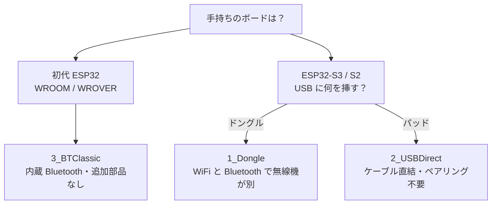
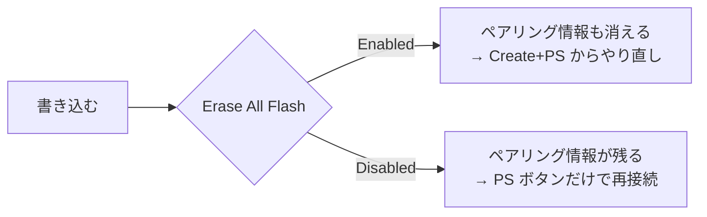
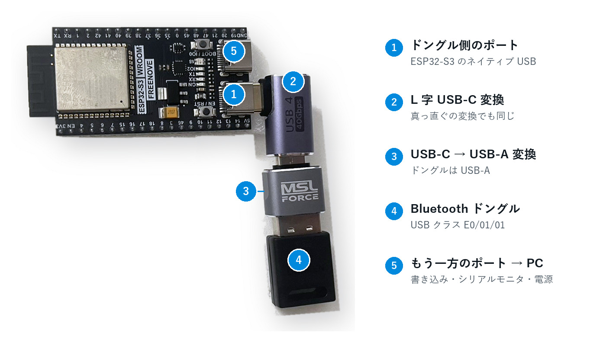
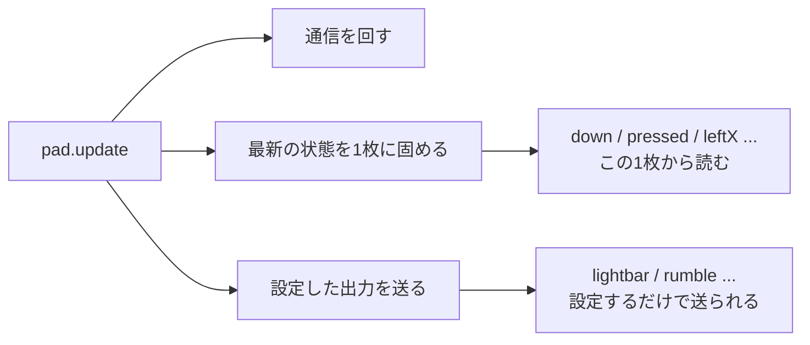
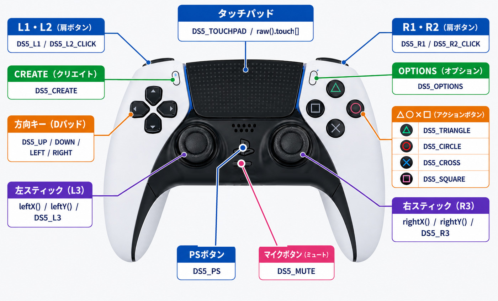

<!-- SPDX-License-Identifier: PolyForm-Noncommercial-1.0.0
     Copyright 2026 yuuki1998 -->

# DualSense32 取扱説明書

**対応コントローラ: DualSense（PS5）／ DualShock 4（PS4）**

PlayStation のコントローラを ESP32 から使うためのライブラリです。名前は
DualSense32 ですが、**DualShock 4（PS4）も同じように使えます**。どちらのパッドも、
このあと出てくる 3 つの繋ぎ方すべてで動きます。
ボタンもスティックもタッチパッドもジャイロも読めますし、ライトバーの色、
振動、それに DualSense ならアダプティブトリガ（引き金の手応え）も出せます。

このページは **ZIP を展開したところから**、最初の 1 本が動いて、
自分のコードが書けるようになるまでを順番に説明します。

---

## 目次

1. [どれで繋ぐか決める](#1-どれで繋ぐか決める)
2. [インストール](#2-インストール)
3. [ボードの設定](#3-ボードの設定)
4. [最初の 1 本を動かす](#4-最初の-1-本を動かす)
5. [コードの読み方](#5-コードの読み方)
6. [入力を全部使う](#6-入力を全部使う)
7. [出力を全部使う](#7-出力を全部使う)
8. [レシピ集](#8-レシピ集)
9. [困ったとき](#9-困ったとき)
10. [早見表](#10-早見表)

---

## 1. どれで繋ぐか決める

繋ぎ方が 3 通りあります。**手持ちのボードで決まります。**



> **なぜ S3 に無線が無いのか**
> ESP32-S3 / C3 / C6 / H2 には **Bluetooth Classic の無線が載っていません**（BLE のみ）。
> どちらのパッドも Bluetooth Classic なので、S3 で無線を使うには外付けのドングルが要ります。
> 逆に初代 ESP32 には Classic がありますが、USB ホスト機能がないのでドングルは使えません。

| | ボード | 追加で要るもの | 特徴 |
|---|---|---|---|
| **1_Dongle** | ESP32-S3 / S2 | Bluetooth ドングル（USB クラス `E0/01/01`）＋ USB-C → USB-A 変換 | 無線。ESP32 内蔵の WiFi とは別の無線機 |
| **2_USBDirect** | ESP32-S3 / S2 | USB-C ケーブル（C to C） | 有線。ペアリング不要 |
| **3_BTClassic** | 初代 ESP32 のみ | なし | 無線。手軽 |

### どちらのコントローラか

**どちらのパッドも 3 経路すべてで動きます。** 経路を決めるのは手持ちのボードで、
持っているコントローラではありません。

DualShock 4 の方が小ぶりです。アダプティブトリガが無く、マイクもミュートボタンも
無く、プレイヤー LED もありません。代わりに**自分で点滅できるライトバー**があり、
タッチパッドは DualSense より縦が短くなっています。
一覧は [6-8](#6-8-相手はどちらのパッドか)、スケッチがどちらのパッド向けかを
書き分ける方法は[第 5 章](#5-コードの読み方)にあります。

2 台目のために読み直す章はありません。違いがあるところは、その機能の説明の中で
その都度書いてあります。

### 実機で確認できていること

「対応」と書くと幅が広いので、確認できた範囲をそのまま書きます。

DualShock 4 は **ESP32-S3** で、**有線とドングルの両方**を、**CUH-ZCT2** の
パッドで動かしました。接続・入力・出力・再接続まで一巡しています。
加速度の大きさは 1.001 G、静止時のジャイロは 0.5 deg/s 以内に収まりました。
この 2 つの数字は、**DualShock 4 用のオフセットを使い、かつパッドが名乗ったあとで
キャリブレーションを読み直して**いなければ出ません。Bluetooth では
キャリブレーションがデバイス判明より先に届くので、リンク側でバイト列を保持して
読み直しています。`5_SelfTest > Ds4Core` は実機で**162 件のプロトコル検証**が
通ります。

**初代 ESP32 の経路（3_BTClassic）はコードは入っていますが、DualShock 4 での
実機確認はできていません。** 判別もデコードも他の経路と同じ仕組みで、まだ実物で
走らせていないだけです。壊れているのではなく、未確認です。

---

## 2. インストール

### 2-1. ZIP を展開する

配布されている `DualSense32-1.6.0.zip` を展開すると、こうなっています。

```
DualSense32/               ← このまま使えます
├── 取扱説明書を開く.html   ← ブラウザで読む
├── 取扱説明書.pdf          ← 印刷用
├── src/
├── examples/
├── docs/
│   ├── DualSense32-manual-ja.html
│   ├── MANUAL-ja.md
│   └── 図の画像
├── library.properties
├── README.md
└── LICENSE
```

### 2-2. IDE に入れてもらう

展開せずに **スケッチ > ライブラリをインクルード > .ZIP形式のライブラリをインストール**
で ZIP をそのまま渡しても入ります。

### 2-3. 直接ライブラリフォルダに入れる場合

`DualSense32` フォルダを、下の場所に**丸ごと**移動します。

| OS | 置き場所 |
|---|---|
| Windows | `ドキュメント\Arduino\libraries\DualSense32\` |
| macOS | `~/Documents/Arduino/libraries/DualSense32/` |
| Linux | `~/Arduino/libraries/DualSense32/` |

置いた後はこうなります。

```
ドキュメント/Arduino/libraries/
└── DualSense32/
    ├── src/                    ← ライブラリ本体
    ├── examples/               ← サンプルスケッチ
    │   ├── 1_Dongle/
    │   ├── 2_USBDirect/
    │   ├── 3_BTClassic/
    │   ├── 4_Troubleshooting/
    │   └── 5_SelfTest/
    ├── docs/
    └── library.properties      ← これがある階層が正しい
```

**`library.properties` は `DualSense32/` の直下**にあります。
`DualSense32/DualSense32-main/library.properties` のように一段深いと認識されません。

### 2-4. Arduino IDE を再起動して確認

再起動したら **ファイル > スケッチ例** を開いてください。
一番下の方に `DualSense32` が出ていれば成功です。

```
ファイル
└── スケッチ例
    └── DualSense32
        ├── 1_Dongle
        │   ├── Basics
        │   ├── DualShock4
        │   ├── ReceiveData
        │   └── SendData
        ├── 2_USBDirect
        ├── 3_BTClassic
        ├── 4_Troubleshooting
        └── 5_SelfTest
```

### 2-5. ESP32 のボード定義（まだ入れていない人だけ）

**ファイル > 環境設定 > 追加のボードマネージャの URL** に次を追加し、

```
https://espressif.github.io/arduino-esp32/package_esp32_index.json
```

**ツール > ボード > ボードマネージャ** で `esp32` を検索してインストールします。
開発と動作確認は **3.3.11** で行っています。

---

## 3. ボードの設定

**ツール** メニューでの設定です。繋ぎ方によって違います。

### 3-1. 初代 ESP32 で使う（3_BTClassic）

| 項目 | 値 | 理由 |
|---|---|---|
| ボード | ESP32 Dev Module | |
| **Partition Scheme** | **Huge APP (3MB No OTA/1MB SPIFFS)** | **必須。** 既定の 1.25MB には収まりません |
| Erase All Flash Before Sketch Upload | 状況による（3-3 参照） | |

Partition Scheme を忘れると `text section exceeds available space` で書き込めません。

### 3-2. ESP32-S3 で使う（1_Dongle / 2_USBDirect）

| 項目 | 値 | 理由 |
|---|---|---|
| ボード | ESP32S3 Dev Module など実物に合わせて | |
| Partition Scheme | 既定のままで入ります | |
| **USB CDC On Boot** | **Enabled** | シリアルモニタに何も出ないときはこれ |

> ボードによっては USB CDC が既定で無効です（LOLIN S3 Mini など）。
> シリアルモニタが**完全に無反応**なときは、まずここを疑ってください。

### 3-3. Erase All Flash — 無線で繋ぐなら重要

ESP32 はペアリング情報をフラッシュに覚えます。**この記憶を消すかどうか**の設定です。



**初めて繋ぐとき、または繋がらなくなったときは Enabled**にしてください。
片方だけが古い鍵を覚えていると、以後ずっと認証で失敗し続けます。
その場合は **ESP32 側は Erase All Flash、パッド側は Create+PS** で、
両方に忘れさせるのが確実です。

### 3-4. ドングルの条件

| 項目 | 条件 |
|---|---|
| USB クラス | `E0/01/01`。これが標準 HCI ドングルの印です |
| 対応 | Bluetooth Classic（BR/EDR）。**BLE 専用は不可** |
| ファームウェア | 内蔵のもの。ホストから流し込んでから動く型は対象外です |
| 電源・速度 | バスパワー 100 mA 程度、フルスピード |
| 形状 | USB-A。S3 は USB-C なので変換が要ります |

箱の **Bluetooth 5.x / 6.0 という表記は関係ありません**。どちらのパッドも Classic なので、
BLE 専用と書いてあるものだけ避けてください。

**開発に使ったもの**は **UGREEN Bluetooth 6.0 アダプタ**（EDR ＆ BLE、Windows 11 / 10 / 8.1 対応）です。
Windows のデバイスマネージャには `BARROT Bluetooth 6.0 Adapter` と出ます。
ESP32-S3 から見えた値は次のとおりで、ファームウェアの転送なしで動きました。

```
vid:pid        33FA:0012
device class   E0/01/01
product        UGREEN BT6.0 Adapter
speed          full
configuration: 2 interfaces, 100 mA
```

`4_Troubleshooting > WhatIsOnUSB` の出力です。挿したドングルがこう出れば当たりです。

### 3-5. ドングルはどこに挿すか

S3 の USB-C は 2 つあります。**ドングルはネイティブ USB 側**です。
もう一方は PC に挿したままにしてください。書き込みとシリアルモニタに加えて、
ドングルの電源もそこから来ます。



*図 3-3　ドングルの挿し方。写真は Freenove ESP32-S3-WROOM*

どちらがネイティブ USB か分からないボードは、**4_Troubleshooting > WhatIsOnUSB**
を書き込んでドングルを挿し替えてください。ドングルの中身が出てくる方がネイティブ USB です。

---

## 4. 最初の 1 本を動かす

**ファイル > スケッチ例 > DualSense32 > （自分の繋ぎ方）> Basics** を開きます。

### 4-1. 書き込む

ボード設定（第 3 章）を済ませて、書き込みます。
**シリアルモニタは 115200 bps** です。

### 4-2. パッドを繋ぐ

**有線（2_USBDirect）なら挿すだけです。** ここから先は無線の話です。

```
       ┌─────────────────────────────────┐
       │  1回目、または Erase Flash 後   │
       └─────────────────────────────────┘

         ①  CREATE ボタンを押したまま
                    ↓
         ②  そのまま PS ボタンも押す
                    ↓
         ③  ライトバーが速く点滅したら離す
                    ↓
              ペアリングモード
                    ↓
         ESP32 が見つけて自分から繋ぎに行く


       ┌─────────────────────────────────┐
       │  2回目以降（記憶が残っている）  │
       └─────────────────────────────────┘

              PS ボタンを押すだけ
```

コントローラの左側、タッチパッドの左上にある小さいボタンが **CREATE** です。

**DualShock 4 では、このボタンの名前が SHARE** です。手順は同じで、SHARE を
押したまま PS も押し、ライトバーが速く点滅したら離します。場所も同じで、
タッチパッドの左にある小さいボタンに、Sony が印刷している古い方の名前が
付いているだけです。

### 4-3. 動いたかどうか

- **× ボタンを押しっぱなし** → ライトバーが赤くなり、両方のモーターが回る
- **離す** → 水色に戻り、振動が止まる
- **左スティックを倒す** → シリアルモニタに `left stick 45,-12` のような行が出る

---

## 5. コードの読み方

`Basics` の中身です。**これが全部**で、他のサンプルはここに表示を足しただけです。

```cpp
#include <DualSense32.h>

DualSense32 pad;                       // ① 用意する

void setup() {
  Serial.begin(115200);
  if (!pad.begin()) Serial.println("begin failed");   // ② 始める
}

void loop() {
  pad.update();                        // ③ 毎回これを呼び出す
  if (!pad.connected()) return;

  if (pad.pressed(DS_CROSS))  Serial.println("cross down");   // ④ 聞く
  if (pad.released(DS_CROSS)) Serial.println("cross up");

  if (pad.down(DS_CROSS)) {
    pad.lightbar(255, 0, 0);           // ⑤ 命じる
    pad.rumble(120, 120);
  } else {
    pad.lightbar(0, 160, 255);
    pad.rumble(0, 0);
  }
}
```

### ① 用意する — 繋ぎ方はここだけで決まる

```cpp
DualSense32 pad;                            // 自動。初代 ESP32 なら内蔵無線、S3/S2 ならドングル
DualSense32 pad(ds_link_usb_hid());        // 有線（S3）  + #include <ds_link_usb_hid.h>
```

**無引数がふつうの書き方です。** `#include <DualSense32.h>` だけで済みます。
初代 ESP32 には Bluetooth Classic があって USB ホストが無い、S3 / S2 はその逆なので、
チップが決まれば無線の経路は 1 通りしかありません。ライブラリがそれを選びます。

**明示が要るのは有線（S3）だけです。** S3 ではドングルもパッドも同じ USB ポートに
挿さるので、どちらのつもりかはコンパイル時には分かりません。既定はドングルです。

経路を明示したいときは、いつでも書けます。

```cpp
DualSense32 pad(ds_bt_bluedroid());        // 初代 ESP32  + #include <ds_bt_bluedroid.h>
DualSense32 pad(ds_link_usb_hci());        // ドングル    + #include <ds_link_usb_hci.h>
```

**3 経路の違いはこの 1 行だけです。** 下のコードは 1 文字も変わりません。

### ② 始める

```cpp
pad.begin();                        // 勝手に探す。ペアリングモードのパッドを見つける
pad.begin("AA:BB:CC:DD:EE:FF");     // このパッドだけに繋ぐ
```

近くに複数台あるとき以外は `pad.begin()` で十分です。
アドレスの打ち間違いは `false` が返るのですぐ分かります。

**アドレスは繋がってから聞けます。** ペアリングして 1 回繋いだあと、

```cpp
char who[18];
if (pad.address(who)) Serial.println(who);   // 24:A6:FA:23:12:64
```

`pad.printEvents(Serial)` を呼び出していれば、繋がった時点で
`link: connected 24:A6:FA:23:12:64` と 1 行出ます。3 経路とも同じです。

### ③ 毎回これを呼び出す

```cpp
pad.update();
```

この 1 行を書き忘れると、**ボタンを押しても反応せず、ライトバーの色も変わりません**。
コントローラとのやり取りはここでしか行われないからです。エラーは出ません。



コントローラからのデータは**裏で動いている通信タスク**が受け取っています。
そのまま読むと「スティックは今のフレーム、ボタンは前のフレーム」という混ざった値になります。
`update()` はその瞬間をコピーするので、そのあと読んだ値は**全部同じ瞬間のもの**です。

### ④ 聞く / ⑤ 命じる

出力は**設定するだけ**です。`send()` を書く必要はありません。
`update()` が送ってくれます。

### どちらのパッド向けか — 書き方は 2 通り

ここまでの内容は DualSense でも DualShock 4 でも同じです。同じでないのは
ハードウェアの方で、DualShock 4 にはアダプティブトリガもマイクもプレイヤー LED
もありません。それをどう扱うかはスケッチ側で決めることになり、答えが 2 つ
あります。**どちらかを意識して選んでください。** 失敗の出方が全く違います。

| | `DualSense32` + `supports()` | `#include <DualShock4.h>` |
|---|---|---|
| 決まるタイミング | 動いている最中 | コンパイルするとき |
| 受け入れるパッド | 挿さった方 | 1 種類だけ |
| 無い機能を叩いたとき | false が返り、数えられ、報告される | ビルドが通らない |

#### 1 つのバイナリで両方受ける

`DualSense32` のまま、書き方も変えずに、パッド側に何があるかを聞きます。

```cpp
if (pad.supports(DS_CAP_ADAPTIVE_TRIGGERS)) pad.triggerRight(block);
if (pad.supports(DS_CAP_PLAYER_LEDS))       pad.playerLeds(10101);
```

「どのパッドか」ではなく「何が要るか」で聞くのがこつです。`supports()` は
ハードウェアの能力を答えるので、このライブラリより新しいパッドが来ても
書いたコードはそのまま通ります。フラグの一覧は
[6-8](#6-8-相手はどちらのパッドか)。

無いかもしれないハードウェアを触る設定関数は `bool` を返し、拒否されたときは
何も変わりません。見落とさないよう回数も数えています →
[7-7](#7-7-そのパッドに無い機能を叩いたとき)。

#### パッドを型で名指しする

```cpp
#include <DualShock4.h>
#include <ds_link_usb_hid.h>

DualShock4 pad(ds_link_usb_hid());
```

`DualShock4` は、同じクラスから**無いハードウェアを取り除いた**型です。
黙って失敗させる代わりに、拒否されるはずだった呼び出しが**そもそもビルドを
通りません**。エラーはその行を名指しします。

```
error: use of deleted function 'bool DualShock4::triggerRight(...)'
error: use of deleted function 'bool DualShock4::micLed(uint8_t)'
error: use of deleted function 'bool DualShock4::playerLeds(...)'
```

ボタンはふつう `DSButton` の共通名（`DS_CROSS`、`DS_CREATE` など）で書けます。Sony が印刷した名前で書きたいときだけ、`DS4_SHARE` などの `DS4Button` 別名も使えます。
`DS4_MUTE` は**そもそも存在しません**。マイクが無く、そのためのボタンも無いから
です。ミュートボタンを取りに行っても、永久に false を返す呼び出しにはならず、
こうなります。

```
error: 'DS4_MUTE' was not declared in this scope
```

`DS5_CROSS` と書くと落ちます。共通の綴りは `DS_CROSS` です。DualSense 専用の別名で書いているということは**別のパッド向けに書かれたスケッチ**という合図なので、まだ安いうちに捕まえます。

> **なぜ `#define` ではこの仕事ができないのか。** Arduino のビルドは、
> ライブラリの `.cpp` を `.ino` とは別々にコンパイルします。スケッチ側で
> 定義したマクロはそこまで届かないので、ライブラリの中身を変えることは
> できません。その境界を越えられるのは**型**だけです。スイッチではなく
> クラスになっているのはそのためです。

実行時のチェックが 1 つだけ残ります。残さざるを得ません。**USB ポートには
「これから何が挿さるか」を前もって聞けない**からです。そのため `connected()` は
本物の DualShock 4 が繋がったときだけ true になり、代わりに DualSense が来た
ときは `mismatched()` が true になります。

```cpp
void loop() {
  pad.update();
  if (pad.mismatched()) return;      // DualSense が来た。スケッチ違い
  if (!pad.connected()) return;

  if (pad.pressed(DS_CREATE)) Serial.println("share");
}
```

このチェックが無いと、DualSense のレポートを DualShock 4 のものとしてデコード
します。落ちもせず、エラーも出ず、ただボタンが一生反応しないスケッチになります。

---

## 6. 入力を全部使う

### 6-1. ボタンの名前



*図 6-1　操作子とコード上の名前。L1 / L2 / R1 / R2 は向こう側の面にあります*

| 実物 | コードでの名前 |
|---|---|
| ↑ → ↓ ← | `DS_UP` `DS_RIGHT` `DS_DOWN` `DS_LEFT` |
| □ × ○ △ | `DS_SQUARE` `DS_CROSS` `DS_CIRCLE` `DS_TRIANGLE` |
| L1 R1 | `DS_L1` `DS_R1` |
| L2 R2 を**底まで**引いたクリック | `DS_L2_CLICK` `DS_R2_CLICK` |
| CREATE / OPTIONS | `DS_CREATE` `DS_OPTIONS` |
| スティック押し込み | `DS_L3` `DS_R3` |
| PS / タッチパッド押し込み / マイク | `DS_PS` `DS_TOUCHPAD` `DS5_MUTE` |

`DualSense32` で書いている限り、この名前は**どちらのパッドでも**そのまま使えます。
`DualShock4` 型で書いた場合（[第 5 章](#5-コードの読み方)）も `DS_CROSS` などの共通名をそのまま使えます。印刷名を優先したいときだけ `DS4_SHARE` などの別名を使います。

| | DualSense | DualShock 4 |
|---|---|---|
| タッチパッドの左の小さいボタン | `DS_CREATE` | `DS_CREATE` |
| ミュートボタン | `DS5_MUTE` | 無い。名前も無い |
| それ以外 | `DS_CROSS` `DS_L1` … | `DS_CROSS` `DS_L1` … 同じ並び |

DualShock 4 を `DualSense32` 経由で読むと、`pad.down(DS5_MUTE)` は常に false
です。パッドが黙っているのではなく、ミュートボタンが無く、その位置のビットが
レポートカウンタだからです。ボタンとしてデコードすると、勝手に点滅するミュートに
なります。この読み出しも拒否として数えられます →
[7-7](#7-7-そのパッドに無い機能を叩いたとき)。

### 6-2. down / pressed / released

3 つは**全部違います**。

```
ボタン        ┌────────────────────┐
の状態   ─────┘                    └──────────

down()        ░░░░░░░░░░░░░░░░░░░░░░       押されている間ずっと true
pressed()     ▓                            押した瞬間の1回だけ true
released()                          ▓      離した瞬間の1回だけ true
```

```cpp
// 押している間モーターを回す → down
if (pad.down(DS_R1)) motorOn(); else motorOff();

// 押すたびに 1 発だけ撃つ → pressed
if (pad.pressed(DS_R1)) fire();

// down で fire() を書くと、押している間ずっと撃ち続けます（毎秒数百発）
```

`pressed()` を使うべきところに `down()` を書くと、押している間ずっと処理が走ります。
**1 回のつもりが毎秒数百回**になります。

### 6-3. スティック

```cpp
int x = pad.leftX();    // -128 〜 127、中央が 0
int y = pad.leftY();
int rx = pad.rightX();
int ry = pad.rightY();
```

```
         leftY = -128（上）
                 ↑
   -128 ←───────┼───────→ +127     leftX
   （左）        │       （右）
                 ↓
         leftY = +127（下）
```

> **Y は下が正です。** 上に倒すとマイナスになります。
> 車を前進させたいときは `-pad.leftY()` を使ってください。

**手を離しても数カウントふらつきます。** これを無視すると、
誰も触っていないのにロボットがじりじり動きます。そのための設定がこれです。

```cpp
pad.deadzone(8);    // ±8 以内は 0 とみなす（既定値 8）
pad.deadzone(0);    // 無効化。生の値が見たいとき
```

### 6-4. トリガ

L2 / R2 は**押し込み具合**と**底まで引いたクリック**の 2 つが取れます。

```cpp
uint8_t r = pad.r2();               // 0〜255 のアナログ値
bool clicked = pad.down(DS_R2_CLICK);   // 底まで引いた
```

```cpp
analogWrite(motorPin, pad.r2());    // アクセルそのもの
```

DualShock 4 でも読み方は全く同じです。こちらのトリガはただのバネなので、
無いのは引くときの手応えの方です
（[7-5](#7-5-アダプティブトリガ--引き金の手応え)）。

### 6-5. タッチパッド

`raw()` から取ります。**2 本まで同時**に追えます。

```cpp
const ds_state_t &s = pad.raw();

if (s.has_touch && s.touch[0].active) {
  Serial.printf("指1 %u,%u (id %u)\n",
                s.touch[0].x, s.touch[0].y, s.touch[0].id);
}
```

```
      (0,0)                                    (1919,0)
        ┌────────────────────────────────────────┐
        │                                        │
        │            タッチパッド                │
        │                                        │
        └────────────────────────────────────────┘
      (0,1079)                                (1919,1079)
```

**DualShock 4 のタッチパッドは幅が同じで、縦が短い 1920 x 942 です。**
幅は同じなので x はそのまま、y だけ実物に合わせてください。1080 のつもりで
扱うと、下端に触れた指が 8 分の 7 くらいの位置として読めます。

`id` は**指を置くたびに増える番号**です。指を滑らせている間は変わらないので、
「同じ指の動きか、置き直したか」を `id` で判別できます。

### 6-6. ジャイロ・加速度

**そのまま使える単位で取れます。** 割り算は要りません。

```cpp
float dps = pad.gyroYaw();     // deg/s。gyroPitch() / gyroRoll() も同じ
float g   = pad.accelZ();      // G。静止していればどれかの軸が約 1.0
```

数値そのものが要るときは 3 通りから選べます。

| 取り方 | 返るもの | 使いどころ |
|---|---|---|
| `pad.gyroYaw()` / `pad.accelZ()` | **deg/s** と **G**（float） | 角速度・加速度としてそのまま使える |
| `pad.raw().motion` | 校正済みの LSB 値（整数） | 整数のまま扱いたい |
| `pad.rawMotion()` | 校正前の LSB 値（整数） | 校正でどれだけ変わったかを見る |

> **自分で割るなら目盛りに注意。** 2 つのセンサは目盛りが違います。ジャイロは 1024 カウントで
> 1 deg/s、加速度は 8192 カウントで 1 G。定数は `DS_GYRO_LSB_PER_DPS` と
> `DS_ACCEL_LSB_PER_G` で公開しています。同じだと思って割ると 60 倍ずれます。

DualShock 4 にもキャリブレーションがあり、専用のフィーチャレポートと専用の
並びから読みます。繋がっているパッドに合わせて読み分けているので、上の説明は
そのパッドでもそのままです。

### 6-7. バッテリ

```cpp
uint8_t level = pad.battery();     // 0〜10（1 が約 10%）
bool charging = pad.charging();
```

### 6-8. 相手はどちらのパッドか

```cpp
if (pad.isDualShock4()) Serial.println("PS4 のパッド");

if (pad.supports(DS_CAP_ADAPTIVE_TRIGGERS)) pad.triggerRight(block);
```

**`isDualShock4()` より `supports()` を使ってください。** 名前ではなく
ハードウェアの能力を答えるので、このライブラリが知らない新しいパッドが来ても
スケッチはそのまま通ります。どちらも意味を持つのは繋がったあとだけです。
それまでの答えは DualSense のものになります。判別できていないパッドは
どこでもそう扱うからです。

| フラグ | 中身 | DualSense | DualShock 4 |
|---|---|---|---|
| `DS_CAP_ADAPTIVE_TRIGGERS` | L2 / R2 が押し返す | あり | なし |
| `DS_CAP_MIC_LED` | ミュートキーのランプ | あり | なし |
| `DS_CAP_MUTE_BUTTON` | ミュートするマイクがある | あり | なし |
| `DS_CAP_PLAYER_LEDS` | タッチパッド下の 5 個の LED | あり | なし |
| `DS_CAP_LIGHTBAR_BLINK` | パッド自身がライトバーを点滅させる | なし | あり |

ライトバー、振動、スティック、トリガ、タッチパッド、モーション、バッテリは
どちらのパッドにもあるので、フラグはありません。

聞きようがないので、フラグになっていない違いが 3 つあります。

| | DualSense | DualShock 4 |
|---|---|---|
| タッチパッド | 1920 x 1080 | 1920 x 942 |
| タッチパッドの左のボタン | CREATE | SHARE |
| ライトバーの点滅 | 自分の loop で作る | `lightbarBlink(on, off)`（[7-6](#7-6-ライトバーの点滅--dualshock-4-のみ)） |

#### どうやって見分けているか

**有線では USB のプロダクト ID から。** どちらのパッドも入力レポートは
`0x01` の 64 バイトなので、レポートそのものでは区別が付きません。
ディスクリプタのプロダクト ID なら区別できます。

| プロダクト ID | パッド |
|---|---|
| `0x05C4` | DualShock 4、CUH-ZCT1 |
| `0x09CC` | DualShock 4、CUH-ZCT2 |
| `0x0BA0` | DualShock 4 の USB アダプタ |

**Bluetooth ではレポート ID から。** 向こうにはプロダクト ID がありません。
`0x31` が DualSense、`0x11` が DualShock 4 です。フィーチャレポートを要求する
までどちらのパッドも送ってくる `0x01` は**何も名乗っていない**ので、
推測材料には**使いません**。ここで推測すると、接続のたびに 1 フレーム目で
パッドをランダムに選ぶことになります。`0x01` のレイアウトは両者同じなので、
判明していない間も正しくデコードできています。

#### 判明するまでの間を埋める — `begin()` に想定を渡す

判明していない間、**出力**だけは困ります。DualSense と DualShock 4 では出力レポート
の形式そのものが違うので、どちらか決まらないと組み立てられません。そこで
`begin()` に想定を伝えられます。

```cpp
pad.begin(DS_DEVICE_DUALSHOCK4);                        // 想定を伝える
pad.begin(DS_DEVICE_DUALSHOCK4, "AA:BB:CC:DD:EE:FF");   // 想定 ＋ MAC
```

`DualShock4` 型なら**型が言っているので書く必要はありません**。`pad.begin()` と
`pad.begin("AA:BB:...")` がそのまま DualShock 4 想定で始まります。

伝えなかった場合、判明するまでの出力は**保留**されます。捨てられはしないので、
`lightbar()` などの設定はパッドが名乗った直後に届きます。数フレーム遅れるだけです。

想定は**リンクが本当に判別したら必ず負けます**。違っていれば `device()` がそう言い、
`DualShock4::mismatched()` が真になります。

#### 答えそのものを固定する — クローン向け

クローンや、このコードより新しい版のために、答えを**上書き**することもできます。
こちらは想定と違い、プロダクト ID より強い。

```cpp
ds_link_usb_hid_force_device(DS_DEVICE_DUALSHOCK4);   // begin() の前に
```

普通は要りません。ログにはパッドが繋がったと出ているのに、スティックから先の
値が全部でたらめ、というときに使ってください。

---

## 7. 出力を全部使う

すべて**設定するだけ**です。`update()` が送ります。

### 7-1. ライトバー

```cpp
pad.lightbar(255, 0, 0);      // 赤
pad.lightbar(0, 160, 255);    // 水色
pad.lightbar(0, 0, 0);        // 消灯
```

### 7-2. 振動

```cpp
pad.rumble(left, right);      // それぞれ 0〜255
pad.rumble(0, 0);             // 停止
```

左が低音の重い振動、右が高音の細かい振動です。

### 7-3. プレイヤー LED

タッチパッドの下に並ぶ 5 個の LED です。**光らせたい形をそのまま書きます。**

```
   pad.playerLeds(10101);   →   ●  ○  ●  ○  ●
   pad.playerLeds(  100);   →   ○  ○  ●  ○  ○
```

```cpp
pad.playerLeds(10101);        // 数字と LED が 1 対 1
pad.playerLeds(  100);        // 頭の 0 は省略できます
pad.playerLeds(11111);        // 全部
pad.playerLeds(    0);        // 全部消灯
pad.playerLeds(10101, 0);     // 第2引数は明るさ 0〜2
```

> すでに 5 ビットのマスクを持っているなら `pad.playerLedsMask(0b10101)` があります。
> 右端の LED がビット 0 です。

**DualShock 4 にはこの LED がありません。** どちらの呼び出しも false を返し、
何も変わりません（[7-7](#7-7-そのパッドに無い機能を叩いたとき)）。

### 7-4. マイク LED

```cpp
pad.micLed(0);   // 消灯
pad.micLed(1);   // 点灯
pad.micLed(2);   // 点滅
```

**DualShock 4 にはマイクも、そのランプもありません。** ここでは false が
返ります（[7-7](#7-7-そのパッドに無い機能を叩いたとき)）。

### 7-5. アダプティブトリガ — 引き金の手応え

DualSense の目玉機能で、この一覧の中で唯一 DualShock 4 に真似のできないもの
です。あちらのトリガはただのバネなので、この節の呼び出しは全部 false が
返ります（[7-7](#7-7-そのパッドに無い機能を叩いたとき)）。

**11 バイトのブロックを作って渡します。**

```cpp
uint8_t block[DS5_TRIGGER_BLOCK_SIZE];      // 11 バイト

ds5_trigger_weapon(block, 3, 6, 8);         // 銃の引き金
pad.triggerRight(block);                    // 右トリガに適用
```

位置は **0〜9 の 10 段階**です。0 が触れていない状態、9 が底まで引いた状態。

```
   0 ─────────────────────────────────── 9
   （離した）                       （底まで）
```

| 関数 | 手応え | 引数 |
|---|---|---|
| `ds5_trigger_off(b)` | 抵抗なし（元に戻す） | — |
| `ds5_trigger_feedback(b, 位置, 強さ)` | そこから先が重い | 位置 0-9 / 強さ 0-8 |
| `ds5_trigger_weapon(b, 開始, 終了, 強さ)` | **銃**。抵抗してカクッと落ちる | 開始 2-7 / 終了 開始+1〜8 / 強さ 0-8 |
| `ds5_trigger_vibration(b, 位置, 振幅, Hz)` | そこから先が振動 | 位置 0-9 / 振幅 0-8 |
| `ds5_trigger_slope(b, 開始, 終了, 強さ1, 強さ2)` | だんだん重くなる | 強さ 1-8 |
| `ds5_trigger_multi_feedback(b, 強さ[10])` | ゾーンごとに重さ指定 | 各 0-8 |
| `ds5_trigger_multi_vibration(b, Hz, 振幅[10])` | ゾーンごとに振動指定 | 各 0-8 |
| `ds5_trigger_bow(b, 開始, 終了, 強さ, 弾き)` | **弓**。張って離すと弾ける | 各 1-8 |
| `ds5_trigger_galloping(b, 開始, 終了, 足1, 足2, Hz)` | **馬の走り**。2 拍のリズム | 足1 0-6 / 足2 足1+1〜7 |
| `ds5_trigger_machine(b, 開始, 終了, 振幅A, 振幅B, Hz, 周期)` | **エンジン**。2 つの振幅が交互 | 振幅 0-7 |

> 下 3 つ（弓・馬・エンジン）は Sony が公開していない機能です。
> 有志が解析したもので、引数の範囲は「実機が受け付けた範囲」です。

**全種類を実際に触って試したいときは `SendData` サンプル**を書き込んでください。
方向キーで切り替えて、L2 / R2 を引き比べられます。

### 7-6. ライトバーの点滅 — DualShock 4 のみ

DualShock 4 は自分でライトバーを点滅させられます。リズムはパッドが刻むので、
警告灯を出しっぱなしにしてもスケッチ側の手間は増えません。

```cpp
pad.lightbar(255, 0, 0);       // 色はこれまでどおり設定する
pad.lightbarBlink(50, 50);     // 0.5 秒点いて 0.5 秒消える
pad.lightbarBlink(200, 1);     // 点灯に見えます。2 秒点灯・10 ms 消灯
```

> **消灯時間に 0 を渡してはいけません。** パッドは新しい色も新しい速さも**点滅の
> 境界でしか受け付けません**。消灯 0 は境界そのものを無くすので、ライトバーは
> それまでの表示を保ったまま、後から送ったものを無視し続けます。`lightbarBlink(0, 0)`
> はさらに悪く、**消灯**します。どちらも「点灯」ではありません。
>
> 点灯に見せたいときは、**長い点灯時間と消灯 `1`** を使ってください。DS4 の実機で
> 確認: 消灯 10 ms は見えず、20 ms は見えます。消灯 `1` なら**1レポートで色も速さも
> 一度で変わります**。

**単位はどちらも 10 ms** なので、50 で 500 ms です。点灯時間と消灯時間なので、
揃える必要はありません。

DualSense にこの機能は無く、false が返ります。両方のパッドで点滅させたいなら、
`millis()` と `lightbar()` で自分の loop で作ることになります。

### 7-7. そのパッドに無い機能を叩いたとき

ここまでに出てきたハードウェアの中には、どちらのパッドにもあるとは限らないものが
あります。無いものを取りに行った呼び出しは、**何も変えずに false を返します**。

| 呼び出し | 無いパッド |
|---|---|
| `triggerLeft` `triggerRight` | DualShock 4 |
| `micLed` | DualShock 4 |
| `playerLeds` `playerLedsMask` | DualShock 4 |
| `lightbarBlink` | DualSense |
| `DS5_MUTE` を読む | DualShock 4 |

```cpp
if (!pad.micLed(1)) Serial.println("このパッドにマイクのランプは無い");
```

リンクが上がる前は何も拒否しません。パッドが名乗るまでは拒否する相手がいないので、
早すぎる呼び出しは DualSense の能力を前提に実行されます。

戻り値は簡単に無視できてしまいますし、この失敗は**通信の側に痕跡が残りません**。
レポートからそのフィールドが消えるだけで、1 フィールド足りないレポートは、
届いたレポートと見分けが付きません。そのため回数も数えています。

```cpp
pad.refusedCount();     // 落とされた呼び出しの回数
pad.lastRefused();      // 最後に落とされた名前。無ければ nullptr
pad.clearRefused();
```

`printEvents()` も、落とした呼び出し 1 回につき 1 行出します。

```
unsupported: triggerRight — this pad is a DualShock 4
```

毎フレーム出るなら、`loop()` のたびに設定関数を呼んでいるということです。
黙らせるより直す方が得です。`supports()` で囲む
（[6-8](#6-8-相手はどちらのパッドか)）か、`DualShock4` 型で書いて、
ビルド時に 1 回だけコンパイラに言わせてください（[第 5 章](#5-コードの読み方)）。

---

## 8. レシピ集

### 8-1. ラジコン（スティックでモーター）

```cpp
#include <DualSense32.h>
DualSense32 pad;

const int PWM_L = 25, PWM_R = 26;

void setup() {
  Serial.begin(115200);
  pinMode(PWM_L, OUTPUT);
  pinMode(PWM_R, OUTPUT);
  pad.begin();
  pad.deadzone(12);          // 手を離したら確実に止める
}

void loop() {
  pad.update();

  // ★ 繋がっていないときは必ず止める
  if (!pad.connected()) {
    analogWrite(PWM_L, 0);
    analogWrite(PWM_R, 0);
    return;
  }

  int fwd  = -pad.leftY();   // 上に倒すとマイナスなので反転
  int turn =  pad.rightX();

  int l = constrain(fwd + turn, -128, 127);
  int r = constrain(fwd - turn, -128, 127);

  analogWrite(PWM_L, abs(l) * 2);
  analogWrite(PWM_R, abs(r) * 2);
}
```

> 電波が切れても、最後に読んだ値はそのまま残ります。`connected()` を見ずに `leftY()` だけで
> 動かしていると、**切れた瞬間の速度でモーターが回り続けます**。
> 繋がっていない間は出力を 0 にしてください。

### 8-2. 押すたびに切り替える（トグル）

```cpp
void loop() {
  pad.update();
  if (!pad.connected()) return;

  static bool lampOn = false;

  if (pad.pressed(DS_CIRCLE)) {     // ★ down ではなく pressed
    lampOn = !lampOn;
    digitalWrite(LAMP, lampOn);
    pad.lightbar(lampOn ? 255 : 0, 0, 0);
  }
}
```

### 8-3. 長押しを検出する

```cpp
void loop() {
  pad.update();
  if (!pad.connected()) return;

  static uint32_t heldSince = 0;
  static bool fired = false;

  if (pad.down(DS_OPTIONS)) {
    if (heldSince == 0) heldSince = millis();
    if (!fired && millis() - heldSince > 1000) {
      fired = true;
      Serial.println("1秒 長押しされた");
    }
  } else {
    heldSince = 0;
    fired = false;
  }
}
```

### 8-4. モード切替（色で今の状態を見せる）

```cpp
enum Mode { MANUAL, AUTO, MODE_COUNT };
Mode mode = MANUAL;

void loop() {
  pad.update();
  if (!pad.connected()) return;

  if (pad.pressed(DS_TRIANGLE)) {
    mode = (Mode)((mode + 1) % MODE_COUNT);
  }

  switch (mode) {
    case MANUAL: pad.lightbar(0, 160, 255); break;   // 水色
    case AUTO:   pad.lightbar(0, 255,   0); break;   // 緑
    default: break;
  }
}
```

### 8-5. とりあえず全部見たい

```cpp
void loop() {
  pad.update();
  pad.printEvents(Serial);       // 変化したものだけ1行ずつ
  if (pad.pressed(DS_OPTIONS)) pad.printState(Serial);   // 今の全部
}
```

配線や動作の確認に使えます。
`ReceiveData` サンプルが、この 2 つを使わずに**手で書いた版**になっているので、
「どの値をどう取るか」を知りたいときはそちらを読んでください。

---

## 9. 困ったとき

| 症状 | 原因 | 対処 |
|---|---|---|
| ジャイロの値が桁違い | 加速度と同じ目盛りで割っている | `pad.gyroYaw()` を使う。手で割るなら 1024（6-6） |
| `text section exceeds available space` | Partition Scheme が既定のまま | **Huge APP** にする（初代 ESP32） |
| シリアルモニタに何も出ない | USB CDC On Boot が無効 | **Enabled** にする（S3） |
| ペアリングモードにしても繋がらない | ESP32 が古い鍵を覚えている | **Erase All Flash = Enabled** で書き込み直し、パッドは Create+PS |
| 繋がった直後に切れる | 両側の鍵が食い違っている | 上と同じ。**両方**忘れさせる |
| `begin failed` と出る | アドレスの書式違い、または無線が起動できない | `"AA:BB:CC:DD:EE:FF"` の形か確認 |
| 誰も触っていないのに動く | デッドゾーンが足りない | `pad.deadzone(12)` などに上げる |
| ボタン1回で何十回も反応する | `down()` を使っている | `pressed()` に変える（[6-2](#6-2-down--pressed--released)） |
| ライトバーも振動も効かない | `update()` を呼び出していない | `loop()` の先頭で `pad.update()` |
| 値が飛ぶ・混ざる | `update()` を loop で複数回、または別タスクから読んでいる | `update()` は1周に1回。読むのは同じタスクで |
| 前は動いたのに急に繋がらない | パッドが別の機器と再ペアリングした | パッドはホストを**1台しか覚えません**。繋ぎ直し |
| 1台目は繋がるのに**別のパッド**が見つからない | 保存されたボンドがスキャンを意図的に止めている | `ds_link_usb_hci_clear_bond()` の後リセット。下記参照 |
| ミュートボタンが一度も反応しない | DualShock 4 にマイクが無い | 読むものが存在しません（[6-1](#6-1-ボタンの名前)） |
| `micLed` / `playerLeds` / トリガ効果が効かない | そのパッドにハードウェアが無い | 戻り値を見るか、先に `supports()`（[7-7](#7-7-そのパッドに無い機能を叩いたとき)） |
| `DualShock4` のスケッチが動くのにボタンが一切来ない | DualSense が挿さっている | `pad.mismatched()` が教えます（[第 5 章](#5-コードの読み方)） |
| スティックから先の値が全部でたらめ | 表に無いプロダクト ID のクローン | `ds_link_usb_hid_force_device()`（[6-8](#6-8-相手はどちらのパッドか)） |

### 別のパッドを隠してしまうボンド

これは症状が「ペアリングできないコントローラ」と見分けが付かないので、
節を分けて書きます。パッドはペアリングモードで点滅し、ESP32 は何も言わず、
思い付く対処は全部あさっての方を向いています。

**ボンドが保存されていると、リンクはインクワイアリスキャンを意図的に止めます。**
ホストを覚えているパッドは PS を押すと自分からホストをページしてくるので、
同時にスキャンを走らせると、そのページに応答できなくなるからです。だから待つ
方が正しい — **そのパッドについては**。まだペアリングしていない別のパッドは、
走らないままのスキャンでしか見つけられません。

なので、先に古いボンドを消します。

```cpp
ds_link_usb_hci_clear_bond(pad.transport());
```

そのあとボードをリセットしてください。ボンドは NVS にあるので、
`Erase All Flash Before Sketch Upload = Enabled` でも同じことができます
（大雑把ですが。[3-3](#3-3-erase-all-flash--無線で繋ぐなら重要)）。

### それでも駄目なとき

**スケッチ例 > DualSense32 > 4_Troubleshooting** に診断用が入っています。

| サンプル | 見えるもの |
|---|---|
| `DongleStepByStep` | ドングルの初期化がどの段階で止まっているか |
| `WhatIsOnUSB` | USB に何がぶら下がっているか（ドングルを認識しているか） |
| `EventLog` | 受信した全項目と、値の整合性チェック |
| `Ds4PairingInfo` | DualShock 4 がまだ呼び続けているホストのアドレス |

`Ds4PairingInfo` は特定の 1 つの沈黙のためのものです。DualShock 4 はホストを
1 台だけ覚えていて PS を押すとそこをページするので、居ないアドレスを呼んでいる
パッドは、光るだけで何も起きません。壊れたパッドと全く同じに見えます。
USB に挿せば — ペアリング不要で — パッドが何を握っているか出てきます。

`5_SelfTest` はライブラリ自体の自己テストです。
**パッドもドングルも不要**で、全部 PASS すればデコード側は健全です。
`Ds4Core` がその DualShock 4 側で、2 つのパッドのレポート配置の違いを
固定している場所でもあります。

---

## 10. 早見表

### 準備

```cpp
DualSense32 pad;                        // 自動（初代=内蔵無線 / S3=ドングル）
DualSense32 pad(ds_link_usb_hid());    // 有線（S3）だけは明示が要る

pad.begin();                 // 探して繋ぐ
pad.begin("AA:BB:...");      // 指名して繋ぐ
pad.update();                // ★ loop の先頭で毎回
pad.connected();             // 繋がっているか
char who[18];
pad.address(who);            // 繋がっている相手のアドレス
pad.deadzone(8);             // スティックの遊び
pad.sendInterval(50);        // 出力の送信間隔 ms（既定 50）
```

### どちらのパッドか

```cpp
pad.device();                // DS_DEVICE_DUALSENSE / DS_DEVICE_DUALSHOCK4
pad.isDualShock4();
pad.supports(DS_CAP_ADAPTIVE_TRIGGERS);   // 他に _MIC_LED, _PLAYER_LEDS,
                                          // _MUTE_BUTTON, _LIGHTBAR_BLINK

DualShock4 pad(ds_link_usb_hid());   // PS4 専用。ビルド時に検査される
                                     // + #include <DualShock4.h>
pad.mismatched();            // DualShock4 型のみ。DualSense が来た

ds_link_usb_hid_force_device(DS_DEVICE_DUALSHOCK4);   // クローン用
```

### 読む

```cpp
pad.down(DS_CROSS)          // 押されている間ずっと
pad.pressed(DS_CROSS)       // 押した瞬間だけ
pad.released(DS_CROSS)      // 離した瞬間だけ
                             // DualShock4 型なら DS_CROSS, DS_CREATE。
                             // DS4_MUTE は存在しない

pad.leftX()  pad.leftY()     // -128〜127（Y は下が正）
pad.rightX() pad.rightY()
pad.l2()     pad.r2()        // 0〜255

pad.battery()                // 0〜10
pad.charging()

pad.raw().touch[0].x         // タッチパッド 0〜1919
pad.raw().touch[0].y         //             0〜1079（DualShock 4 は 941 まで）
pad.gyroPitch() / gyroYaw() / gyroRoll()   // deg/s
pad.accelX()    / accelY()  / accelZ()    // G
pad.raw().motion             // 校正済みの LSB 値
pad.rawMotion()              // 校正前の LSB 値
```

### 書く

```cpp
pad.lightbar(r, g, b);       // 各 0〜255
pad.rumble(left, right);     // 各 0〜255
pad.playerLeds(10101);       // 光らせたい形をそのまま
pad.playerLedsMask(0b10101); // ビットで持っているなら
pad.micLed(1);               // 0 消灯 / 1 点灯 / 2 点滅
pad.lightbarBlink(50, 50);   // DualShock 4 のみ。単位は 10 ms

uint8_t b[DS5_TRIGGER_BLOCK_SIZE];
ds5_trigger_weapon(b, 3, 6, 8);
pad.triggerLeft(b);
pad.triggerRight(b);

// 上記はハードウェアの無いパッドでは全部 false を返す
pad.refusedCount();          // 落とされた回数
pad.lastRefused();           // 最後に落とされた名前
pad.clearRefused();
```

### 覗く

```cpp
pad.printEvents(Serial);     // 変化したものだけ
pad.printState(Serial);      // 今の全部
```

---

## ライセンス

Copyright 2026 yuuki1998 — [PolyForm Noncommercial License 1.0.0](../LICENSE)

非商用利用に限ります。個人の学習・趣味・研究、学校やその他の非営利団体
（例: 学校のロボコン部が学生大会に出る）での利用・改変・再配布ができますが、
商用での利用はこのライセンスの対象外です。再配布するときは `LICENSE`、`NOTICE`、
`LICENSES/Apache-2.0.txt` を一緒に配ってください。`src/stack/` と `src/osi/` の
Bluedroid 抜粋ヘッダは Apache-2.0 のままです。

DualSense、DualShock、PlayStation は Sony Interactive Entertainment Inc. の
商標です。本プロジェクトは Sony とは無関係で、承認も受けていません。
